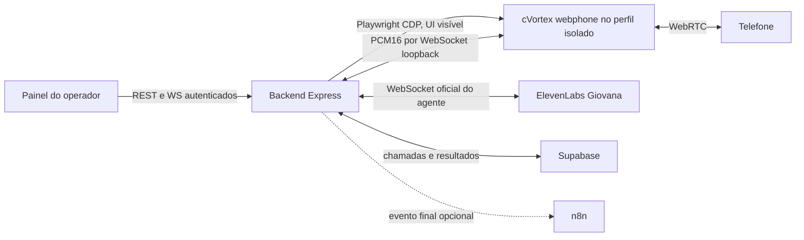

# Arquitetura do piloto local cVortex + ElevenLabs

O backend autentica o operador por cookie HttpOnly, valida número e bloqueio de contato, cria o registro antes da discagem e aciona a UI cVortex via Playwright. A ponte local transporta áudio efêmero de `receiver.track` para ElevenLabs e entrega a resposta ao `sender.replaceTrack()`. Chaves e URL assinada ficam no backend; os dados do login cVortex ficam no perfil isolado do navegador. Áudio não é salvo no Supabase nem no n8n.

Em 06/11/2026, foi corrigido um corte de áudio na ponte: o navegador descartava chunks quando a fila de reprodução ultrapassava 0,9 s. A reprodução agora enfileira todos os chunks recebidos e usa 180 ms de margem para variação no recebimento. O workflow antigo da Giovana, que ainda continha nós de “Teste de Áudio” e “Triagem”, foi substituído por um único nó de captação; a cópia anterior está em [giovana-workflow-backup-2026-11-06.json](giovana-workflow-backup-2026-11-06.json).
No teste telefônico após a correção, o operador confirmou que as frases saíram completas, sem cortes, e que a Giovana respondeu no contexto de captação sem mencionar “teste de áudio”.

`POST /api/calls` inicia somente após clique do operador; `POST /api/calls/:id/takeover` fecha a ponte da IA, restaura o microfone original e mantém a chamada ativa; `POST /api/calls/:id/end` aciona desligamento na UI. `GET /api/calls/:id` e `/ws/calls/:id/events` expõem estado. `GET /api/integrations/status` informa prontidão de cVortex, ElevenLabs e banco. A monitoria simultânea permanece indisponível.

Cada cérebro ativo aponta para um Agent ID da ElevenLabs. O cérebro inicial de captação pode usar o ID legado do ambiente; novos cérebros exigem ID próprio. As opções de Confirmação, Faltosos e Contexto personalizado foram criadas inativas. O contexto armazenado no banco é uma anotação para configuração do agente remoto e não é aplicado automaticamente durante a chamada.

O controlador está em `server/src/cvortex-provider.ts`, a orquestração e os estados em `server/src/services.ts`, o acesso ao banco em `server/src/repository.ts`, e os eventos autenticados em `server/src/monitor.ts`. A tabela `calls` usa `provider='cvortex'` e `cvortex_call_id` opcional, além do ID de conversa ElevenLabs. A migração é aditiva para os IDs de cVortex e remove a coluna legada de telefonia anterior; o banco ativo não tinha chamadas quando isso foi aplicado.

## Limite operacional

Esta arquitetura é um **piloto local**, porque depende do layout e do ciclo de vida do webphone e usa a modalidade `Ligar para um Colaborador`, sem contrato público de originação/áudio da cVortex. A cVortex não forneceu ainda API oficial para iniciar/encerrar chamada ou media stream para este tenant. Um sistema de produção deve trocar o controlador de UI por integração suportada, mantendo o contrato de `services.ts` e o mesmo frontend. Ver [mapa de integração](cvortex-integration-map.md) e [plano de QA](cvortex-local-migration-qa-plan.md).
